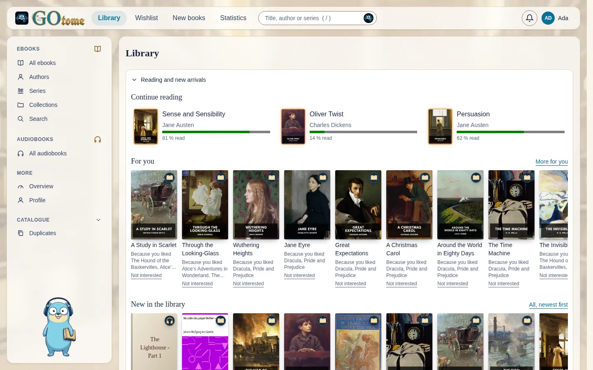
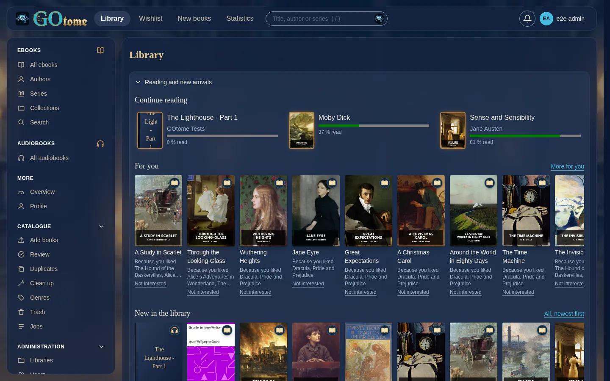
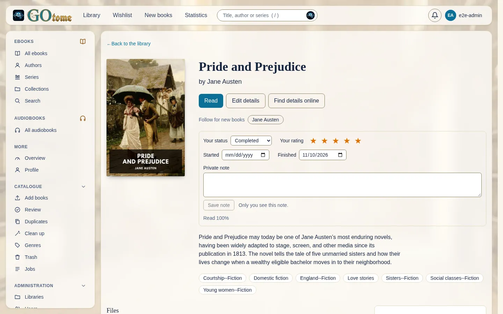
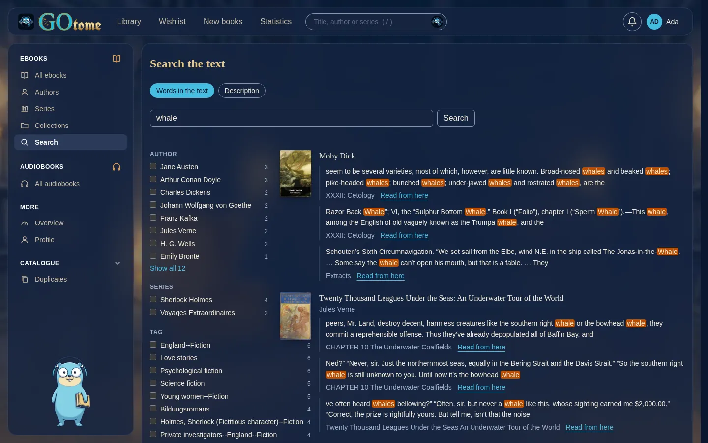
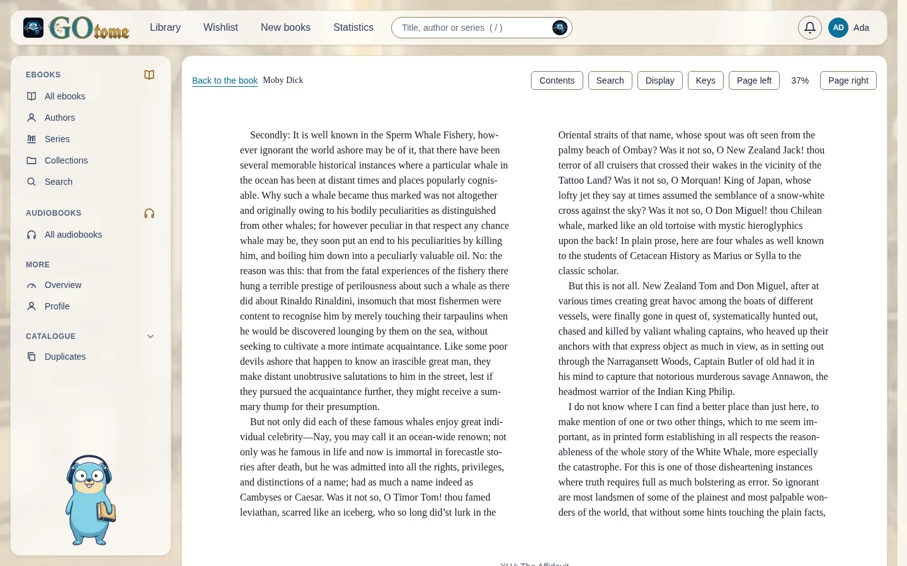
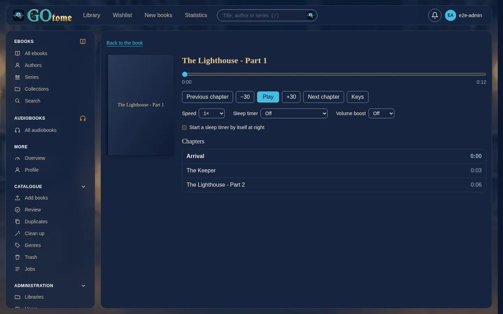
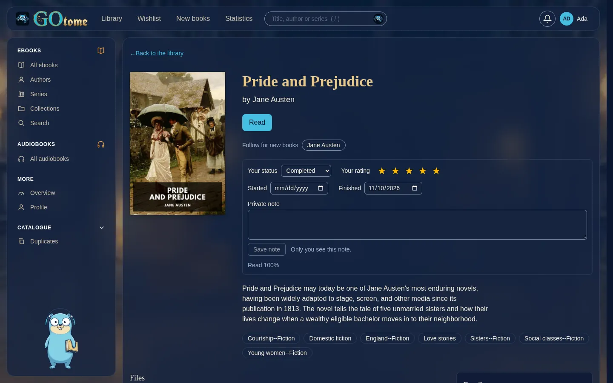
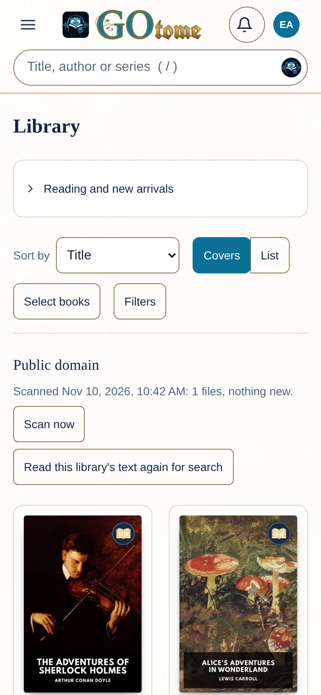
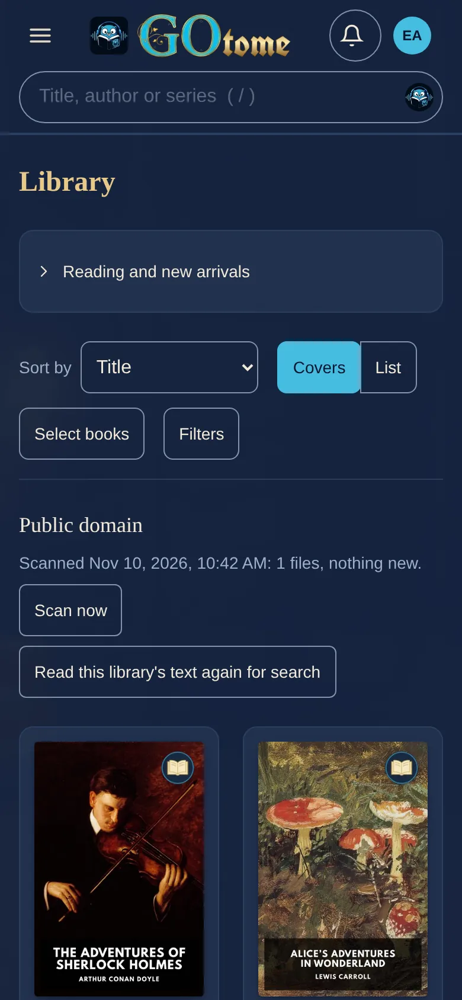

<p align="center">
  
</p>

# GOtome

Self-hosted library manager for ebooks, PDFs and audiobooks.

Read ebooks and PDFs in the browser, listen to audiobooks, find books by a
word of their text, send them to your e-reader, and share the library with
your household, each person with their own reading state.

- Libraries of folders you already have, or of uploads GOtome arranges;
  a Calibre library moves in with its metadata, covers and ratings
- Details from Open Library, CrossRef and Hardcover; editing, writing them
  back into EPUBs, bulk changes and a review queue
- Exact and near-duplicate detection, with merging and replacing
- Filters, smart shelves, collections, a wishlist; typo-tolerant full-text
  search inside the books' text, and search by description
- In-browser EPUB, Kindle and PDF reader and audiobook player, with the
  reading place kept in step across devices; reading statistics
- Similar books, worked out from what books are about
- Following authors and series for new books, with notifications
- KOReader (OPDS and progress sync), Kobo, and Tolino
- Readers, editors and administrators; shared and private libraries;
  single sign-on through OpenID Connect

## Screenshots

Made from a stack holding only public-domain books (`make screenshots`); click one for its full size.
Or try it yourself in the [demo](https://praetorianer777.github.io/GoTome/), which runs in your browser with public-domain books, with no server and nothing kept after a reload.

<p align="center">
  <a href="docs/screenshots/library-light.webp"></a>
  <a href="docs/screenshots/library-dark.webp"></a>
</p>

<table>
  <tr>
    <td><a href="docs/screenshots/book-light.webp"></a><br>A book's page</td>
    <td><a href="docs/screenshots/search-dark.webp"></a><br>Search inside the books</td>
  </tr>
  <tr>
    <td><a href="docs/screenshots/reader-light.webp"></a><br>The reader</td>
    <td><a href="docs/screenshots/audiobook-dark.webp"></a><br>The audiobook player</td>
  </tr>
  <tr>
    <td><a href="docs/screenshots/book-dark.webp"></a><br>Dark colours</td>
    <td align="center"><a href="docs/screenshots/phone-library-light.webp"></a><a href="docs/screenshots/phone-library-dark.webp"></a><br>On a phone</td>
  </tr>
</table>

## Stack

Go backend, React and Tailwind CSS frontend, PostgreSQL. A deployment is two
containers: the app and the database.

## Quick start

You need Linux with Docker and Docker Compose v2. Everything a deployment
needs is the folder `deploy`:

```bash
git clone https://github.com/praetorianer777/GoTome.git
cd GoTome/deploy
cp .env.example .env   # optional: pin the version, change the port
docker compose up -d
```

Open <http://localhost:8080>; the first visit asks you to create the
administrator. Then make a library, from a folder you mount into the app
container or from uploads, as [getting started](docs/getting-started.md)
walks through.

## Performance on a real library

Measured with `gotome perf-check` ([docs/performance.md](docs/performance.md))
on GOtome 0.13.0 with 48,560 books, 3.19 million text chunks and bge-m3
vectors for every book, on 2 CPUs and 14.5 GiB of memory:

| What | Time |
| --- | --- |
| Library lists, filters, authors, series, a book's page, duplicates, reviews | 1 to 80 ms |
| Facets of the whole library | 628 ms |
| Quick search | 303 ms |
| Full-text search | 523 ms |
| Similar books | 2.1 s |
| Facets of quick-search matches | 1.8 s |
| Phrase search | 1.3 s |

The last three are being worked on ([#456](https://github.com/praetorianer777/GoTome/issues/456)).

## Running it in detail

Each release publishes the image for amd64 and arm64 as
`ghcr.io/praetorianer777/gotome`. Everything a deployment needs is the folder
`deploy`:

```bash
git clone https://github.com/praetorianer777/GoTome.git && cd GoTome/deploy
cp .env.example .env   # optional: pin the version, change the port
docker compose up -d
```

Then open <http://localhost:8080> and create the first account. A short-lived
`init` container gives the installation its own random database password and
encryption key on the first start and keeps them in the `secrets` volume; nobody
has to choose or type them. The key encrypts what is stored for other services,
such as API tokens: back up the `secrets` volume together with the database, or
those have to be entered again.

The [documentation](docs/README.md) takes it from there:
[getting started](docs/getting-started.md) (libraries, a reverse proxy),
the [configuration reference](docs/configuration.md),
[backing up and upgrading](docs/backup-and-upgrade.md),
[e-readers](docs/devices.md), [troubleshooting](docs/troubleshooting.md) and
[accessibility](docs/accessibility.md), where it stands and how to report a barrier.

## Development

Every change belongs to an issue and lives on a branch `<type>/<issue>-<slug>`;
see [CLAUDE.md](CLAUDE.md). `./run-tests.sh` is the gate that must pass before a push.

## How it is made

Most of GOtome's code is written by AI agents (Claude) under the direction of
one maintainer. Every change still passes the same gate: the push gate
(`./run-tests.sh`), CI in four browsers, the visibility tests every route must
pass, and the scale, backup and upgrade tests.

## Security

Report vulnerabilities privately, as [SECURITY.md](SECURITY.md) describes.

## Licence

[Apache 2.0](LICENSE)

The artwork is based on the Go gopher, designed by
[Renée French](https://go.dev/blog/gopher) and licensed under
[CC BY 4.0](https://creativecommons.org/licenses/by/4.0/).
